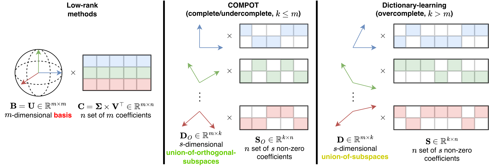
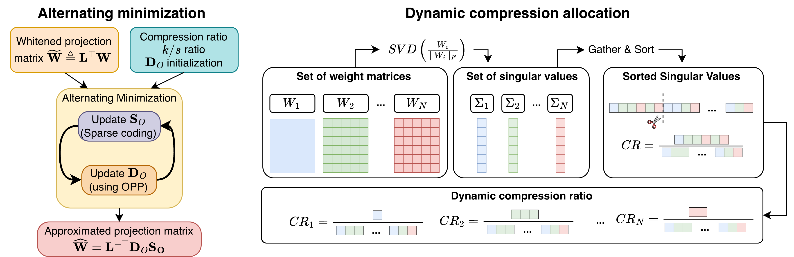

<div align="center">


<!-- # COMPOT -->

### Calibration-Optimized Matrix Procrustes Orthogonalization<br>for Transformers Compression

**Denis Makhov · Dmitriy Shopkhoev · Magauiya Zhussip · Ammar Ali · Baher Mohammad · Stamatios Lefkimmiatis**

**NeurIPS 2026**

[Paper](https://arxiv.org/abs/2602.15200) · [PDF](https://arxiv.org/pdf/2602.15200v3) · [Reproduction guide](docs/REPRODUCIBILITY.md) · [Checkpoints & calibration](docs/ARTIFACTS.md) · [Results](docs/PAPER_RESULTS.md)


&nbsp;&nbsp;&nbsp;

&nbsp;&nbsp;&nbsp;


</div>

COMPOT compresses transformer weights into a learned dictionary and sparse
coefficients. Calibration activations guide the approximation, alternating
sparse coding and orthogonal Procrustes updates in the whitened space. A
spectral allocator distributes the storage budget across layers and projections.

This official release provides the original COMPOT allocator and solver,
calibration tools, COMPOT / CoSpaDi / SVD-LLM experiment recipes, factorized
Transformers checkpoints and direct evaluation with the Language Model Evaluation Harness.

<p align="center">
  
  <br><em>COMPOT combines calibration-aware reconstruction with a compact dictionary and sparse coefficients.</em>
</p>

<p align="center">
  
  <br><em>Alternating dictionary optimization and sparse coding (left), spectral allocation (right).</em>
</p>

## Install

The standalone release uses **Python 3.13, PyTorch 2.9.1 with CUDA 12.8,
Transformers 4.55.4 and lm-eval 0.4.8**. Use a CUDA-capable Linux machine and
[uv](https://docs.astral.sh/uv/):

```bash
git clone https://github.com/mts-ai/COMPOT.git
cd COMPOT
uv sync --locked --extra eval --extra test
uv run --locked --no-sync compot-run --help
uv run --locked --no-sync pytest -q
```

**Original paper environment.** We used the NVIDIA container
`nvcr.io/nvidia/pytorch:25.04-py3` (cluster notation:
`nvcr.io#nvidia/pytorch:25.04-py3`). [setup.sh](setup.sh) preserves the dependency
installation commands for that container:

```bash
docker run --gpus all --rm -it --ipc=host \
  -v "$PWD":/workspace/COMPOT -w /workspace/COMPOT \
  nvcr.io/nvidia/pytorch:25.04-py3 bash
source setup.sh
```

Both the uv environment and setup script use lm-eval 0.4.8, as specified
in the paper.

## Run an experiment

Download the release artifacts:

- [Calibration data](https://disk.yandex.ru/d/3RwESGstkyY9lA)
- [Deployable checkpoints](https://disk.yandex.ru/d/04MqoMUthjrw5Q)

Place the downloaded files under the layout in the [artifact guide](docs/ARTIFACTS.md).
Extract the model's calibration archive and pass the extracted model folder explicitly:

```bash
export ARTIFACT_ROOT=/path/to/compot_artifacts
unzip "$ARTIFACT_ROOT/calibration/Qwen3-0.6B-calibration.zip" -d calibration

uv run --locked --no-sync compot-run \
  experiments=qwen3_06b_compot_cr02 \
  calib_root="$PWD/calibration/Qwen3-0.6B" \
  checkpoint_root="$PWD/checkpoints" \
  run_dir="$PWD/runs/qwen3_06b_cr02"
```

This runs original dynamic allocation, COMPOT compression and full zero-shot
evaluation. The recipe uses **CR 0.2, k/s = 2, 20 iterations and seed 42**. CR is the fraction of decoder-core
storage removed: 0.2 means a 20% reduction, not 20% retained storage.

| Model | Recipe prefix | Available CR suffixes |
| :-- | :-- | :-- |
| Qwen3-0.6B | `qwen3_06b_compot_` | `cr02`, `cr03`, `cr04` |
| Qwen3-8B | `qwen3_8b_compot_` | `cr02`, `cr03`, `cr04` |
| Llama-3.2-1B | `llama32_1b_compot_` | `cr02`, `cr03`, `cr04` |
| Llama-3-8B | `llama3_8b_compot_` | `cr02`, `cr03`, `cr04` |

Use `dry_run=true` to inspect a run without compressing or evaluating.
`stages.evaluate=false` runs compression only. The uniform-allocation ablation
uses `method.extra_args.allocation=uniform`.

### Methods

| Method | Qwen3-0.6B CR 0.2 recipe | Factorization |
| :-- | :-- | :-- |
| COMPOT | `qwen3_06b_compot_cr02` | Calibration-aware orthogonal dictionary and sparse coefficients |
| CoSpaDi | `qwen3_06b_cospadi_cr02` | Calibration-aware K-SVD dictionary and sparse coefficients |
| SVD-LLM | `qwen3_06b_svdllm_cr02` | Calibration-whitened truncated SVD, dense U/V factors, k/s = 1 |

All three methods cover the four models at CR 0.2, 0.3 and 0.4 and export
standalone Transformers checkpoints. The shared modeling files load exact
factor shapes from the checkpoint; SVD-LLM uses dense factors without a mask.
Sparse methods include support-mask bytes in their storage budget.

To evaluate a saved model, supply its directory:

```bash
uv run --locked --no-sync compot-run experiments=qwen3_06b_compot_cr02 \
  checkpoint_path=/path/to/downloaded/checkpoint
```

The pipeline skips calibration and compression when a complete checkpoint is
available. Repeating a generation command also reuses completed calibration
and matching compression outputs. See the [artifact guide](docs/ARTIFACTS.md).

## Load a compressed model

Fresh compression saves a deployable checkpoint in the output's `transformers/`
directory; `runs/.../results.json` records its `model_path`. Downloaded
checkpoints are standalone model directories:

```python
import torch
from transformers import AutoModelForCausalLM, AutoTokenizer

path = "/path/to/compot_artifacts/reproductions/qwen3_06b/cr_0.2"
tokenizer = AutoTokenizer.from_pretrained(path)
model = AutoModelForCausalLM.from_pretrained(
    path,
    trust_remote_code=True,
    torch_dtype=torch.bfloat16,
    device_map="auto",
)
inputs = tokenizer("The purpose of model compression is", return_tensors="pt")
inputs = inputs.to(model.get_input_embeddings().weight.device)
print(tokenizer.decode(model.generate(**inputs, max_new_tokens=32)[0]))
```

Deployable checkpoints store BF16 U/V factors. Sparse coefficients use
`packed_mask_v1` with nonzero values and one-bit masks; dense coefficients
use `dense_uv_v1` without a mask (inside a `factorized_v1` checkpoint). Factorized projections keep original factors without fused
weight copies or persistent dense coefficient caches. `compression_manifest.json`
reports actual tensor storage, including buffers, decoder norms and biases.
Embeddings and the output head are excluded from the decoder-core budget and
remain in the full checkpoint. Temporary forward memory is additional.

The checkpoint modeling files include optional **MACKO** support through
`model.optimize()`. The portable packed forward does not imply acceleration. See [deployment details](docs/REPRODUCIBILITY.md#deployable-format-and-macko).

## Evaluate directly

```bash
export CHECKPOINT="$ARTIFACT_ROOT/reproductions/qwen3_06b/cr_0.2"
uv run --locked --no-sync python -m lm_eval --model hf \
  --model_args pretrained="$CHECKPOINT",dtype=bfloat16,trust_remote_code=True \
  --tasks mmlu,arc_easy,arc_challenge,hellaswag,piqa,lambada_openai,race,wikitext,sciq \
  --batch_size auto:1 --device cuda:0 --num_fewshot 0 \
  --output_path runs/evaluation/qwen3_06b_cr02
```

The eight accuracy tasks use `acc_norm` where available and `acc` otherwise;
the reported average is their unweighted mean. WikiText word perplexity and
LAMBADA perplexity are reported separately. Do not add a sample limit when
comparing with full paper results. See the [guide](docs/REPRODUCIBILITY.md#evaluation)
for two-GPU data-parallel evaluation and protocol caveats.

## Results

COMPOT results with dynamic allocation. Published values follow the paper;
Qwen3-8B dynamic results are from the accompanying author table. Accuracy
is the eight-task average (%); lower perplexity is better.

| Model | Core reduction | Avg. accuracy ↑ | WikiText PPL ↓ | LAMBADA PPL ↓ |
| :-- | --: | --: | --: | --: |
| Qwen3-0.6B | 20% | 40.9 | 70 | 190 |
|  | 30% | 39.1 | 250 | 380 |
|  | 40% | 34.7 | 3,800 | 5,000 |
| Qwen3-8B | 20% | 67.17 | 15.30 | 5.52 |
|  | 30% | 65.40 | 17.59 | 5.30 |
|  | 40% | 59.00 | 22.79 | 6.42 |
| Llama-3.2-1B | 20% | 50.1 | 21 | 14 |
|  | 30% | 45.0 | 36 | 32 |
|  | 40% | 37.6 | 130 | 190 |
| Llama-3-8B | 20% | 65.3 | 12 | 4.6 |
|  | 30% | 60.9 | 17 | 6.6 |
|  | 40% | 51.7 | 43 | 22 |

[Full task results](docs/PAPER_RESULTS.md) include baselines and static
ablations for all four models. Machine-readable values are available in
[llm_results.csv](results/llm_results.csv) and
[paper_summary.csv](results/paper_summary.csv).

For questions about evaluation metrics, please open a
[GitHub issue](https://github.com/mts-ai/COMPOT/issues).

## Reproducibility and artifacts

- [Reproduction guide](docs/REPRODUCIBILITY.md): calibration, allocation, compression, evaluation and storage accounting.
- [Artifact guide](docs/ARTIFACTS.md): checkpoint locations, calibration archives and checksums.
- [Paper results](docs/PAPER_RESULTS.md): reported accuracy and perplexity values.
- [Asset attribution](assets/README.md): figures and affiliation branding.

## Citation

```bibtex
@article{makhov2026compot,
  title={COMPOT: Calibration-Optimized Matrix Procrustes Orthogonalization for Transformers Compression},
  author={Makhov, Denis and Shopkhoev, Dmitriy and Zhussip, Magauiya and Ali, Ammar and Mohammad, Baher and Lefkimmiatis, Stamatios},
  journal={arXiv preprint arXiv:2602.15200},
  year={2026}
}
```

## License

Code is released under the [Apache License 2.0](LICENSE); see [NOTICE](NOTICE)
for attribution. Paper figures are CC BY 4.0. Model checkpoints
remain subject to their base models' licenses, and affiliation logos retain
their owners' trademark rights.
